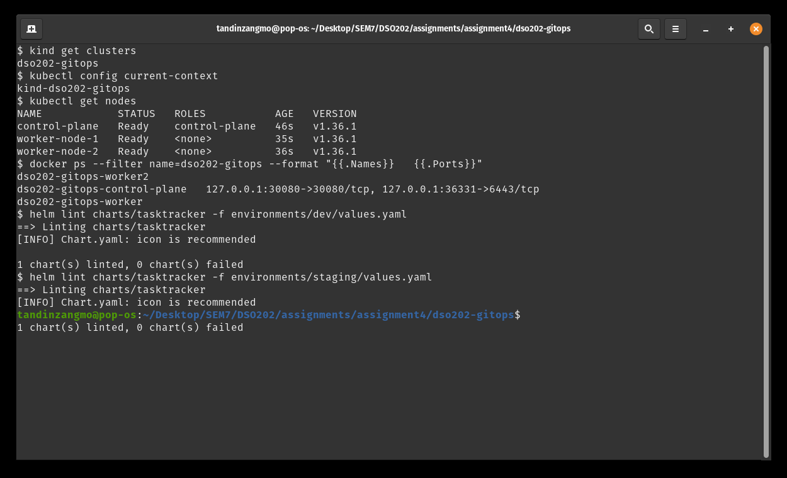
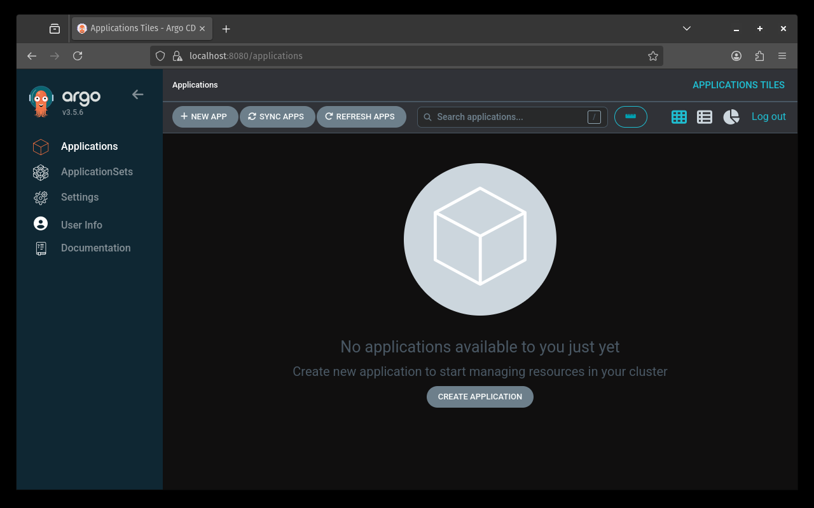
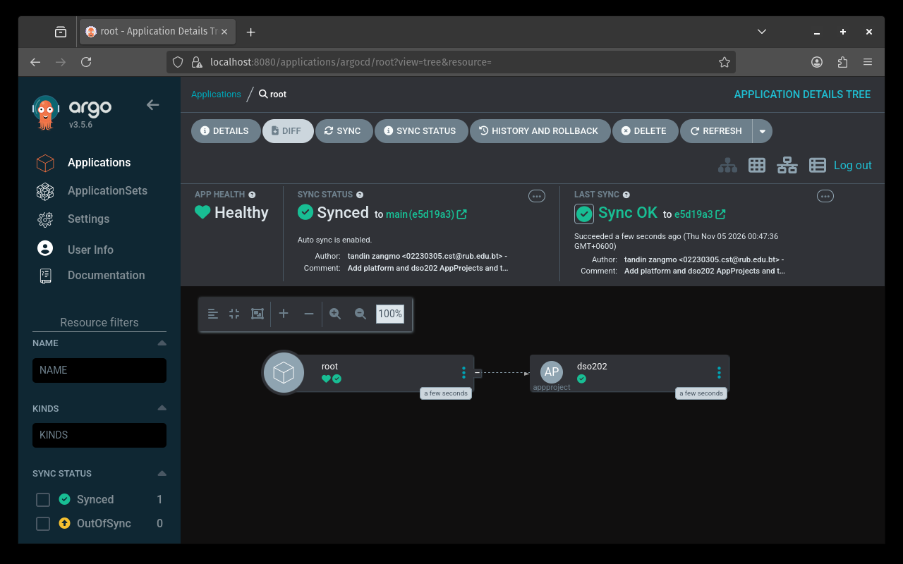
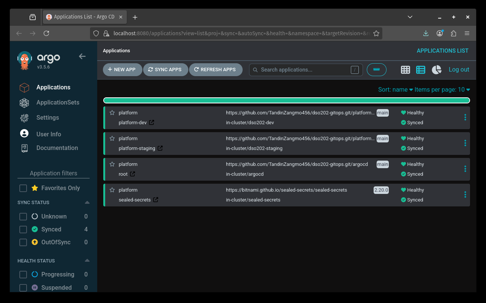
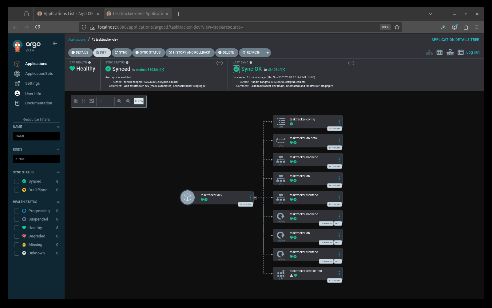
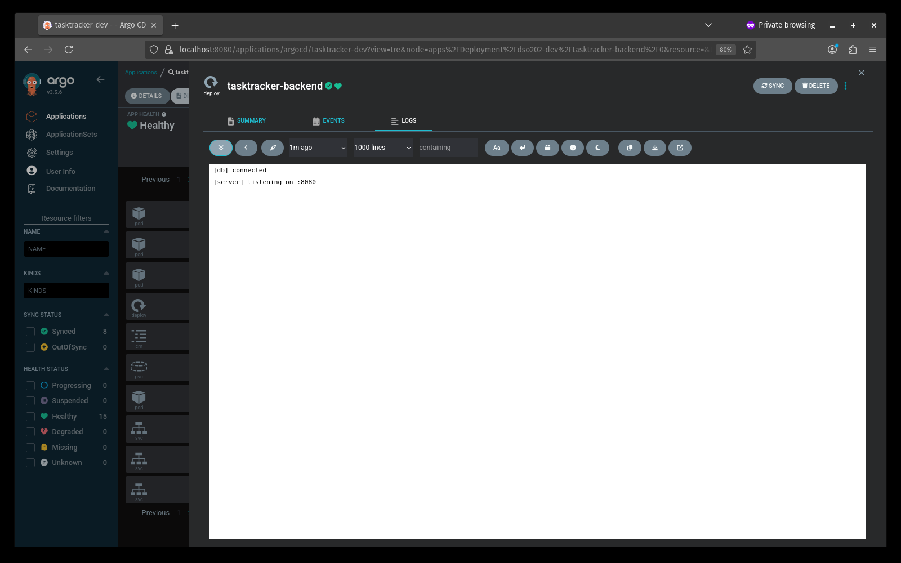
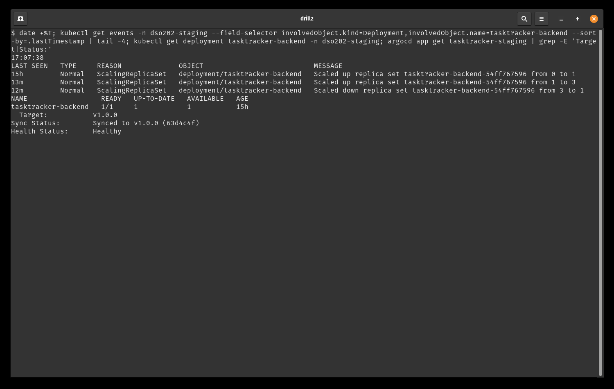
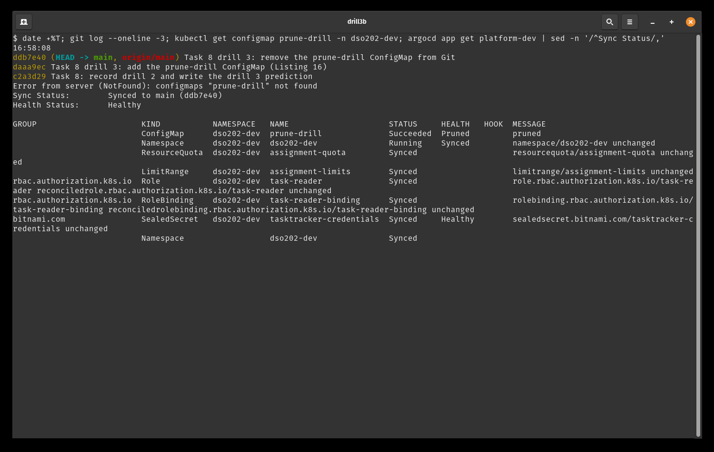
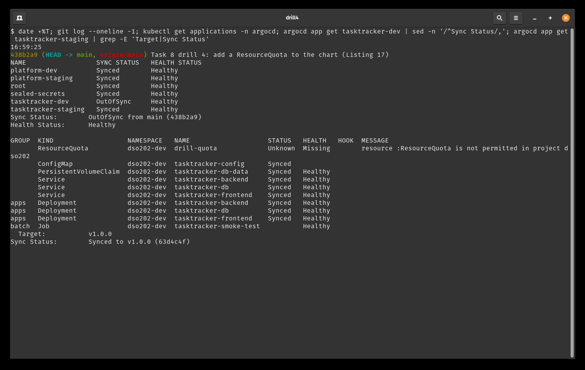

# DSO202 Assignment 4, GitOps Delivery of the Task Tracker with Argo CD

**Tandin Zangmo**
**Student number:** 02230305
**Submission date:** [submission date]

---

## 1. Introduction

In Assignments 1 to 3 I deployed the three-tier Task Tracker by running commands myself: `kubectl apply`, then Kustomize, then `helm install`. In this assignment that step is removed. Argo CD runs inside the cluster, reads my Git repository `dso202-gitops`, and makes the cluster match it. My job was to build the repository, prove that each GitOps principle holds in the running system, and record the evidence.

All command output is kept in [evidence.md](evidence.md). This report explains what I did, what I saw, and what went wrong along the way.

## 2. Architecture and the two environments

Everything runs on my laptop in one kind cluster called `dso202-gitops`, with one control-plane node and two workers. It has four namespaces that matter:

| Namespace | What runs there |
| --- | --- |
| `argocd` | Argo CD itself, seven Pods, plus every Application and AppProject object |
| `sealed-secrets` | the Sealed Secrets controller, which holds the sealing key |
| `dso202-dev` | the Task Tracker for dev |
| `dso202-staging` | the Task Tracker for staging |

The cluster cannot be reached from GitHub, so Argo CD polls my repository every 60 seconds.

Only two things are applied by hand. `bootstrap/argocd` installs Argo CD from the pinned v3.5.6 manifest, and `bootstrap/root` creates the `platform` project and the `root` Application. The root then reads the `argocd/` folder and creates everything else in sync-wave order:

1. wave -3: the `dso202` project
2. wave -2: the Sealed Secrets controller
3. wave -1: `platform-dev` and `platform-staging` (namespace, quota, limits, RBAC, sealed credentials)
4. wave 0: `tasktracker-dev` and `tasktracker-staging` (the Helm chart)

Inside the chart there are more waves: database 0, backend 1, frontend 2, and then the PostSync smoke-test Job.

There are two projects. `platform` is the administrator project and may deploy any kind into `argocd`, `sealed-secrets` and the two app namespaces. `dso202` is the workload project. It may only deploy into `dso202-dev` and `dso202-staging`, may not create any cluster-scoped kind, and may only create the five kinds my chart renders: Deployment, Service, ConfigMap, PersistentVolumeClaim and Job.

The two environments use the same chart. They differ only in their values file and in the Git revision they follow:

| | dev | staging |
| --- | --- | --- |
| Revision | branch `main` | a tag, `v1.0.0` at first |
| Sync | automated, with prune and self-heal | manual |
| Values | `environments/dev/values.yaml` | `environments/staging/values.yaml` |
| Frontend | NodePort 30080, mapped to `localhost:30080` | NodePort 30081, reached with `kubectl port-forward` |
| Credentials | SealedSecret in `platform/dev/` | separate SealedSecret in `platform/staging/` |

So dev gets every merge within about a minute, while staging only changes when someone moves its tag in Git and then presses sync.

## 3. Tasks

### Task 1: Repository, chart contract and cluster

I created the public repository `TandinZangmo456/dso202-gitops` with `gh` and cloned it into my assignment folder. The first commit is only the `.gitignore` from Listing 1, so key backups and plaintext secrets were ignored before any other file existed.

I then copied in the Practical 1 kind configuration, my Assignment 3 Helm chart, and the Assignment 2 quota, LimitRange, Role and RoleBinding. I imported the chart unchanged first and then fixed it one contract item at a time, so each change has its own commit. The main changes were:

- The chart rendered a Secret and a ResourceQuota and LimitRange. I deleted those templates (C3, C8). The Pods now read the Secret named in `credentials.existingSecret`, which is `tasktracker-credentials`.
- Image tags fell back to the chart `appVersion`. Now every tier has its own `image.tag` value and the chart refuses to render without it (C1). I also added an `extraEnv` list for each tier (C2).
- There were no readiness probes, sync waves or progress deadlines. I added all three (C4, C5, C6). The probes are values, and the backend one calls `/api/status`.
- I renamed the chart from `task-tracker` to `tasktracker`. Otherwise the objects would have been called `tasktracker-task-tracker-backend`. I also removed the old `helm test` Pod, because the smoke-test Job in Task 5 does the same job.

The tutor's images are built for arm64 only and my laptop is amd64. My tutor approved using my own amd64 rebuilds, which I already had locally from the earlier assignments. I pushed them to my Docker Hub account as `penguintandinzangmo/dso202-{frontend,backend,db}:1.0`.

Memory was a problem from the start. Docker Desktop on my laptop only gave its VM 1.7 GiB, and the brief recommends at least 6 GB. My laptop has 7.1 GiB in total. I switched to the native Docker Engine, which can use all of the host memory, and stopped Docker Desktop to free its VM.

Both `helm lint` runs were clean, and the chart renders only ConfigMap, Deployment, PersistentVolumeClaim and Service. The kind cluster `dso202-gitops` came up with three nodes, and host port 30080 is mapped on the control-plane node. The first `kubectl get nodes` showed the nodes as `NotReady` because I ran it straight after creation. After waiting they were all `Ready`.

*Figure 1: kind cluster, port mapping and helm lint for both environments*

### Task 2: Install Argo CD declaratively

I saved Listings 2 to 5 in `bootstrap/argocd/` and committed them before applying anything. The kustomization points at the upstream `install.yaml` for the exact tag `v3.5.6`, and two patches add my own settings: a 60 second polling interval, the `reviewer` account, the health check for Application objects, and an RBAC policy that only lets `reviewer` read the `dso202` project.

Before applying, I rendered the result with `kubectl kustomize`. It had 6 Deployments and 1 StatefulSet. All 59 namespaced objects were in `argocd`, and the images came from ghcr.io, public.ecr.aws and quay.io, so none of them count against the Docker Hub pull limit. I then applied it with server-side apply as the brief says, and every object was created.

This is where I hit my biggest problem so far. While the Pods were starting, my laptop disk filled up completely. The first wait timed out for `argocd-repo-server` and `argocd-server`, and the repo-server log said `mkdir /tmp/_argocd-repo: no space left on device`. My shell could not even show output any more. I checked what was using the space and removed old Docker images from other courses, the Docker build cache, and some rebuildable caches. That freed about 17 GB. I did not change anything in the cluster or in Git. Once there was space, the Pods restarted by themselves, and the second wait passed with all seven Pods `Running` and the three CRDs present.

Signing in also took a few tries. I ran `argocd login` through the chat panel, which cannot pass keyboard input to the password prompt, so the login never finished. My first `argocd account get-user-info` failed with "server address unspecified", and I kept that in the evidence. I then did the login in a normal terminal window, where it worked. `argocd version` shows that both the client and the server are v3.5.6, and the `argocd-cm` ConfigMap has my three settings.

*Figure 2: Argo CD UI after signing in as admin*

### Task 3: AppProjects and the root Application

First I compared the project whitelist in Listing 8 with what my chart really renders. The listing allows Deployment, StatefulSet, Service, ConfigMap, ServiceAccount and Job. My chart renders Deployment, Service, ConfigMap and PersistentVolumeClaim, plus the smoke-test Job that comes in Task 5. My database is a Deployment with a volume claim, not a StatefulSet, and the chart has no ServiceAccount. The brief says the list must match exactly, so I removed StatefulSet and ServiceAccount and added PersistentVolumeClaim with a comment explaining why.

I saved Listings 6, 7 and 8 with my GitHub user name and checked that the repository URL was spelled the same way in all three files. I pushed to `main` before applying anything, because the root reads `argocd/` from GitHub and not from my laptop.

After `kubectl apply -f bootstrap/root`, the root became `Synced` and `Healthy` within a few seconds. The three projects `default`, `platform` and `dso202` exist. `dso202` was created by the root, not by me. It appears in the resource list of `argocd app get root`, and its tracking annotation names the root, while `platform` has no such annotation. kubectl printed a warning about the finalizer name not being domain-qualified. This comes from the finalizer that the listing uses on purpose, so I left it as it is.

*Figure 3: root Application resource tree*

### Task 4: Platform layer and Sealed Secrets

I added the Sealed Secrets Application (Listing 9) and pushed it. The root picked it up and installed chart 2.20.0, which runs the controller image 0.40.0. The `SealedSecret` CRD appeared a few seconds later. Before sealing anything, I backed up the controller's key to `../dso202-keys/sealing-key.backup.yaml` with mode 600. The file is outside the repository and I never opened it. The evidence only shows `ls -l`.

The plaintext input files gave me more trouble than I expected. I opened them in a text editor, but nothing was saved, so my first check found no files at all. I kept that failed check in the evidence. In the end the two files were made by a script that writes a random password into each file and never prints it. Dev and staging got different passwords, and the DB_* and POSTGRES_* values match inside each file.

I sealed each file for its own namespace with the pipeline from the brief, so the plaintext Secret only ever existed inside the pipe. Then I added the namespaces (Listing 11 and a staging copy) and the two platform Applications. I wrote `platform-staging.yaml` by copying `platform-dev.yaml` and changing only the name, path and namespace. After the push, both platform Applications became `Synced` and `Healthy`. The controller created a `tasktracker-credentials` Secret with the four keys in each namespace, and the quota, LimitRange, Role and RoleBinding from Assignment 2 were all delivered from Git.

I also made a mistake that I caught in time. I wrote the database user names into the evidence text, but a user name is also a credential value. I removed it before committing, and a search of every file and every commit found no trace of it. Finally I searched the whole history for every credential value: four keys in each of the two environments, eight searches in total. Every search came back empty.

*Figure 4: platform and sealed-secrets Applications, all Synced and Healthy*

### Task 5: Deploy dev and staging

I added the PostSync smoke-test Job to the chart first. The URL in Listing 13 did not match my Service name, so I changed it to `tasktracker-backend:8080` and explained this in the file header. I pushed it and tagged that commit `v1.0.0`, which is the baseline staging is pinned to. Then I added the two Task Tracker Applications. Dev follows `main` and syncs by itself. Staging follows the tag and has no `automated` block.

While dev came up, I kept a timestamped watch on the Pods. The order was exactly the sync waves. The database became ready at 01:15:23 and the backend Pod was only created one second later. The backend became ready at 01:16:32 and the frontend Pod was created at 01:16:33. The smoke-test Pod started only after the frontend was ready and finished at 01:17:33, and its log printed the three seeded tasks. Most of the time was spent pulling images onto the new nodes.

The dev frontend answered on `localhost:30080`. The page itself cannot call the backend from my browser, because `BACKEND_URL` is the in-cluster name `tasktracker-backend`, the same as in Assignment 1. So I tested create, read, update and delete through a port-forward to the backend with `curl`, and all four worked.

Staging stayed `OutOfSync` and `Missing` after the push, because nothing in it syncs by itself. The brief expected the root to be `Progressing` at this point. In my cluster the root stayed `Healthy`, although its resource list showed `tasktracker-staging` as `Missing`. I wrote down what I actually saw.

My first `argocd app sync tasktracker-staging` failed with "connection refused". My laptop had run out of memory, and `argocd-server` and the repo-server were restarted, which also killed my port-forward. I closed Chrome and VS Code, waited for the Argo CD Pods to be ready again, restarted the port-forward and ran the same sync again. This time it finished in about two minutes, with the same wave order as dev, and the smoke test passed. After that all six Applications were `Synced` and `Healthy`. The staging frontend returned HTTP 200 through a port-forward on port 8081, and its NodePort is 30081 as set in the staging values.

*Figure 5: tasktracker-dev resource tree in the Argo CD UI*

### Task 6: Access control for Argo CD users

`argocd account list` showed the two accounts, `admin` and `reviewer`. I set the reviewer password and signed in as reviewer under its own CLI context, so the admin session was kept. In the CLI, reviewer saw only `tasktracker-dev` and `tasktracker-staging`. `can-i get applications` said yes, while `can-i sync` and `can-i get logs` said no, and reading the `platform` project was denied.

My first UI test went wrong. The private window was signed in as admin, not reviewer, so when I pressed Sync the sync was accepted. It only re-synced dev to the commit it was already on. I recorded it, signed out, and checked the server log and the User Info page before trying again as reviewer. This time Sync was refused with "permission denied", and the Deployment panel had no Logs tab.

I then enabled the logs line in the RBAC patch, committed it, and applied the bootstrap layer again. This ConfigMap is not managed by the root, so the commit alone would not have changed anything in the cluster. `can-i get logs` changed to yes, but the UI still showed no logs. The Pods were missing from the Argo CD tree, even for admin. The Argo CD documentation explains that a project hides every child resource whose kind it does not permit, and my `dso202` whitelist only had the five kinds the chart renders. This clashes with the Task 3 rule that the list must match the chart exactly, so I had to choose. I added ReplicaSet and Pod to the project in a separate commit with a comment. The cost is that the project could now also create a bare Pod. After that the Pods appeared in the tree.

The log viewer was still blank. The server log showed that following a log failed on my laptop with "too many open files", because only 128 inotify instances are allowed per user. I switched off the Follow button, and the reviewer could read the backend Pod logs.

*Figure 6: reviewer session showing the backend Pod logs*

### Task 8: Drift, pruning and project guardrails

I did Task 8 before Task 7, because Task 7 needs 1.1 images that are not available yet, and none of the drills depends on them. For each drill I wrote the prediction in the evidence file and committed it before running anything. All four predictions held.

In drill 1 I scaled the dev backend to 3 by hand. Argo CD set it back to 1 in about one second, much faster than I expected. The two extra Pods were killed after the 30 second grace period, which suggests the backend does not stop cleanly on SIGTERM. This is self-heal at work.

In drill 2 I did the same in staging. Nothing changed by itself. Argo CD only marked staging `OutOfSync`, and the diff showed 3 replicas against 1. Only my manual sync put it back. This is the gate between dev and staging: Argo CD reports drift but does not act on it without a person.

*Figure 7: drill 2, staging scaled to 3 and back to 1 only after a manual sync*

In drill 3 I added a throwaway ConfigMap to `platform/dev` and then removed it with `git rm`. It appeared in under a minute and was pruned 21 seconds after the second push. The namespace file is protected with `Prune=false`, because deleting a namespace would also delete the database volume. I explained this but did not test it.

*Figure 8: drill 3, the ConfigMap pruned after the file was removed from Git*

In drill 4 I added a ResourceQuota to the chart. The sync was refused with "resource :ResourceQuota is not permitted in project dso202", nothing was created, and staging stayed on `v1.0.0`. I restored dev by reverting the commit. One surprise was that the failed sync kept retrying the old commit for about seven minutes after the revert, until its five retries ran out. Dev stayed `Synced` and `Healthy` during that time.

*Figure 9: drill 4, the ResourceQuota refused by the dso202 project*
